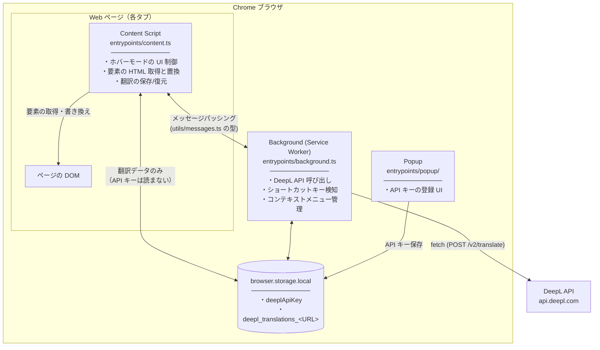
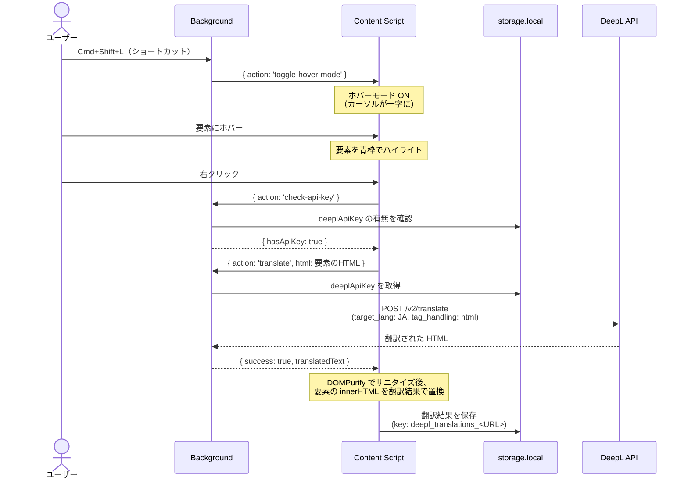
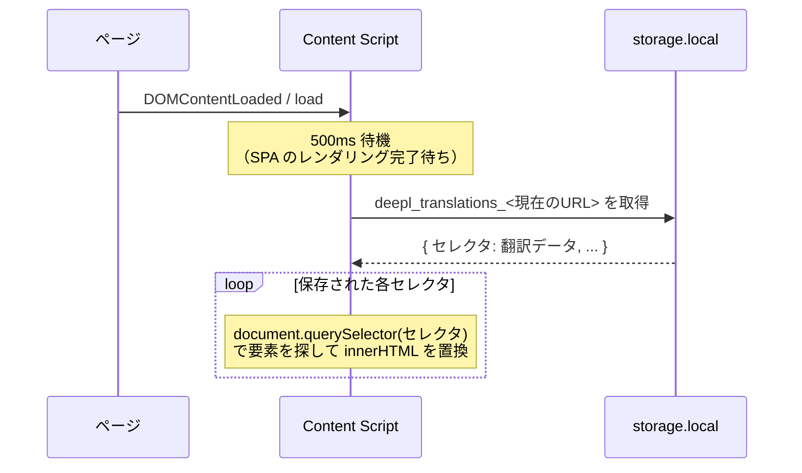

# Hover Translator for DeepL API

DeepL API を使用して、ページの一部（ホバーで選択した要素）を翻訳する非公式のブラウザ拡張機能。
[WXT](https://wxt.dev/) + TypeScript で構築されている。

## 機能

- **ホバー翻訳モード**: `Cmd+Shift+L`（Mac）/ `Ctrl+Shift+L` でモードを ON/OFF。ホバーした要素が青枠でハイライトされ、右クリックでその要素を日本語に翻訳する。`ESC` でモード解除。10,000 文字を超える要素は誤操作による API 消費を防ぐため翻訳を中止する。
- **翻訳の永続化**: 翻訳結果は URL ごとに保存され、次回ページを開いたときに自動で復元される。保存から 30 日を過ぎたデータは復元時に自動削除される。
- **翻訳の解消**: ページ上で右クリック → コンテキストメニュー「表示中のページの翻訳を解消する」で、保存済み翻訳を削除してリロードする。ポップアップの「保存した翻訳をすべて削除」で全ページ分を一括削除できる。
- **API キー管理**: ツールバーの拡張機能アイコンをクリックして開くポップアップから DeepL API キーを登録する。Free プラン（キー末尾 `:fx`）/ Pro プランの両方に対応し、キーに応じて `api-free.deepl.com` / `api.deepl.com` を自動で使い分ける。
- **通知**: エラー等の通知はページ右上の toast 表示で行う（`alert` / `confirm` は不使用）。

## Chrome 拡張の基礎知識

Chrome 拡張は「1 つのプログラム」ではなく、**役割の異なる複数のスクリプトが別々の環境で動き、メッセージをやり取りする**構成になっている。この拡張で使っているのは次の 3 つ。

| コンポーネント | 実行場所 | できること / できないこと |
|---|---|---|
| **Background (Service Worker)** | ブラウザのバックグラウンド。ページとは無関係に常駐（アイドル時は停止） | 外部 API への fetch、コンテキストメニュー、ショートカットキー検知などの Chrome API が使える。**ページの DOM は触れない** |
| **Content Script** | 閲覧中の各 Web ページに注入される | ページの **DOM を読み書きできる**。使える Chrome API は限定的（storage・メッセージングなど）。外部 API への fetch は CORS 制約を受けるため background に依頼する |
| **Popup** | ツールバーのアイコンをクリックすると開く小さな HTML ページ | 普通の Web ページと同じ。設定 UI に使う。閉じると消える |

これらは実行環境が完全に分かれているため、直接関数を呼び合うことはできず、次の 2 つの手段で連携する。

- **メッセージパッシング**: `browser.runtime.sendMessage()` / `browser.tabs.sendMessage()` で相互にメッセージを送る（この拡張では型を `utils/messages.ts` に定義）
- **共有ストレージ**: `browser.storage.local` は全コンポーネントから読み書きできる共有の Key-Value ストア

## アーキテクチャ図



## 処理フロー

### 1. 翻訳の実行



ポイント:

- Content Script は CORS の制約で DeepL API を直接呼べないため、background にメッセージで依頼する。
- API キーは background だけが読む。全サイトに注入される Content Script からはキーの「有無」しか確認できない（`check-api-key` メッセージ）。
- API から返る HTML は `innerHTML` に反映する前に [DOMPurify](https://github.com/cure53/DOMPurify) でサニタイズする（保存済み翻訳の復元時も同様）。
- `tag_handling: 'html'` を指定して HTML ごと翻訳させることで、リンクや装飾タグの構造を保ったまま翻訳できる。
- 保存時は要素を特定するための **CSS セレクタ**（`#id` や `div.class:nth-of-type(2) > p` のようなパス）をキーとして生成する（`generateSelector()`）。

### 2. 翻訳の復元（ページ再訪問時）



復元済みの要素には `data-deepl-translated="true"` 属性を付けて二重適用を防ぎ、`data-deepl-original` に元の HTML を保持している。

### 3. 翻訳の解消

コンテキストメニュー「表示中のページの翻訳を解消する」→ background がその URL のストレージキーを削除し、タブをリロードする。

## ストレージの構造

`browser.storage.local` に保存されるデータ:

```
deeplApiKey: "xxxx-xxxx-..."   ← Popup から登録される API キー

deepl_translations_<ページURL>: {
  "<CSSセレクタ>": {
    translatedText: "翻訳後の HTML",
    originalHtml:   "翻訳前の HTML",
    timestamp:      1720000000000
  },
  ...
}
```

`timestamp` から 30 日を過ぎたエントリは、ページ再訪問時の復元処理で自動的に削除される。

## ディレクトリ構成

WXT では `entrypoints/` 配下のファイル名・ディレクトリ名がそのまま拡張機能のコンポーネントとして認識される（`manifest.json` への登録は WXT が自動で行う）。

```
├── entrypoints/
│   ├── background.ts      # Background (Service Worker)
│   ├── content.ts         # Content Script（全 URL に注入）
│   └── popup/             # Popup UI
│       ├── index.html
│       ├── main.ts
│       └── style.css
├── public/
│   └── icon-{16,32,48,128}.png  # 拡張機能アイコン（WXT が manifest に自動登録）
├── utils/
│   └── messages.ts        # コンポーネント間メッセージの型定義・ストレージキー生成
├── docs/
│   └── STORE_LISTING.md   # Chrome ウェブストア提出用の下書き・チェックリスト
├── PRIVACY.md             # プライバシーポリシー（ストア提出時に URL 登録が必要）
├── wxt.config.ts          # manifest の設定（permissions・ショートカットキーなど）
└── package.json
```

### WXT について

[WXT](https://wxt.dev/) は Chrome 拡張のビルドフレームワーク。素の拡張機能開発と比べて次の面倒を肩代わりしてくれる。

- `manifest.json` の自動生成（`wxt.config.ts` と `entrypoints/` の構成から生成）
- TypeScript のビルド、`defineBackground` / `defineContentScript` などのヘルパーの自動 import
- `browser` グローバル（Chrome / Firefox 両対応のクロスブラウザ API）の提供
- 開発時の HMR（`pnpm dev` でブラウザが自動起動し、変更が即反映される）

## 開発

```sh
pnpm install        # 依存インストール（postinstall で wxt prepare が走る）
pnpm dev            # 開発モード（Chrome が起動し拡張が読み込まれる）
pnpm build          # 本番ビルド（.output/ に出力）
pnpm zip            # ストア提出用の zip を作成
pnpm compile        # 型チェックのみ（tsc --noEmit）
```

### ビルド済みの拡張を Chrome に読み込む

1. `pnpm build` を実行する（`.output/chrome-mv3/` に出力される）
2. Chrome で `chrome://extensions` を開く
3. 右上の「デベロッパーモード」を ON にする
4. 「パッケージ化されていない拡張機能を読み込む」をクリックし、`.output/chrome-mv3/` フォルダを選択する

`.output` は隠しフォルダのため、macOS のファイル選択ダイアログには表示されない。`Cmd + Shift + .` で隠しファイルの表示を切り替えるか、`Cmd + Shift + G` でパスを直接入力して移動する。

コードを変更した場合は `pnpm build` し直し、`chrome://extensions` の拡張カードにある更新（リロード）ボタンを押すと反映される。

## 必要な権限（wxt.config.ts）

| 権限 | 用途 |
|---|---|
| `storage` | API キー・翻訳結果の保存 |
| `activeTab` | ショートカット押下時のアクティブタブへのメッセージ送信と、コンテキストメニュー操作時の `tab.url` の取得 |
| `contextMenus` | 「翻訳を解消する」メニューの追加 |
| `host_permissions: https://api.deepl.com/*`<br>`https://api-free.deepl.com/*` | Background からの DeepL API 呼び出し（Pro / Free プラン） |

## ストア公開

Chrome ウェブストアへの提出手順・掲載文の下書き・パーミッションの正当性説明は [docs/STORE_LISTING.md](docs/STORE_LISTING.md) にまとめている。提出用 zip は `pnpm zip` で `.output/` に生成される。
